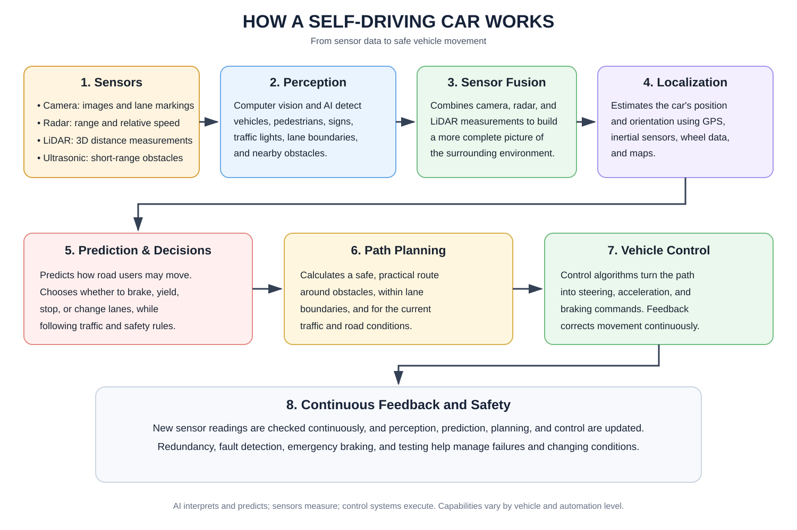

# Exploration-of-AI-Use-Case-Case-study-on-self-driving-cars

# AIM

To study the application of Artificial Intelligence (AI) in self-driving cars and understand how AI technologies help vehicles perceive their surroundings, make decisions, and navigate safely without continuous human control.

# THEORY

Self-driving cars combine AI, sensors, maps, and control systems to perform driving tasks. Their operation follows a continuous cycle of sensing, understanding the environment, planning, and vehicle control.

**1. Sensors:** Cameras capture road images, signs, lane markings, and nearby road users. Radar measures object distance and relative speed, LiDAR creates 3D distance measurements, and ultrasonic sensors detect nearby obstacles at short range.

**2. Environmental perception:** Computer vision and machine-learning models analyse sensor data to detect and classify vehicles, pedestrians, cyclists, traffic lights, signs, and road boundaries.

**3. Sensor fusion:** Data from different sensors are combined to produce a more complete view of the surroundings. For example, a camera can classify a vehicle while radar estimates its distance and speed.

**4. Localization and mapping:** The car estimates its position and orientation using sources such as GPS, inertial sensors, wheel measurements, and maps. This helps it understand where it is relative to the road and planned route.

**5. Prediction and decision-making:** The system estimates how nearby road users may move, then selects an action such as slowing down, stopping, yielding, or changing lanes while accounting for traffic rules and safety constraints.

**6. Path planning:** Algorithms calculate a suitable path to the destination while considering obstacles, lane boundaries, road geometry, and changing traffic conditions.

**7. Vehicle control:** Control systems translate the planned path into steering, acceleration, and braking commands. Feedback from sensors helps correct the vehicle's movement in real time.

**8. Continuous feedback and safety:** The car repeatedly updates its perception and decisions as new sensor data arrives. Redundancy, fault detection, emergency braking, and extensive testing help manage failures and unexpected conditions. Capabilities vary by vehicle and automation level; AI does not guarantee error-free driving.

# RESULT

The study explains how AI, sensors, perception, sensor fusion, localization, planning, and control work together in self-driving cars. Safe operation depends on reliable data, sound decisions, accurate control, and appropriate safety measures.
